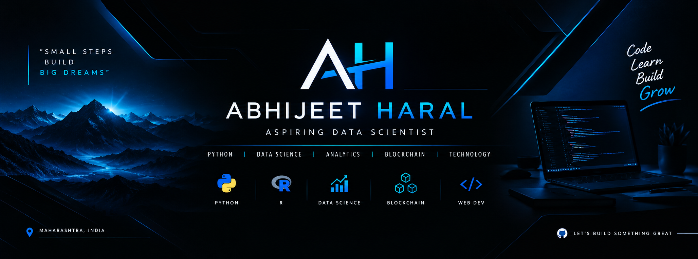

<!-- ================================================= -->
<!--              ABHIJEET HARAL                     -->
<!--             GITHUB PROFILE README               -->
<!-- ================================================= -->

  

<h1 align="center">ABHIJEET HARAL</h1>

<h3 align="center">
  ASPIRING DATA SCIENTIST | PYTHON DEVELOPER
</h3>

  <b>BUILDING. LEARNING. INNOVATING.</b>
   
  Turning ideas into code and transforming knowledge into real-world solutions.

  

---

## 👨‍💻 ABOUT ME

Hello! I'm **Abhijeet Haral**, a FY BSc Data Science student passionate about programming, technology, and solving real-world problems.

- 🎓 Pursuing BSc in Data Science.
- 🐍 Learning Python programming.
- 📊 Exploring Data Science and Data Analytics.
- 🔗 Interested in Blockchain technology.
- 💡 Building practical projects and improving my technical skills.
- 🚀 Working towards becoming a skilled Data Scientist.

> **MY MINDSET:** Learn continuously. Build consistently. Improve relentlessly.

---

## 🛠️ TECH STACK & TECHNOLOGIES

  

### Currently Exploring

- Python Programming
- R Programming
- Data Analytics
- Data Science Fundamentals
- Blockchain Technology
- Web Development

---

## 🚀 FEATURED PROJECTS

| PROJECT | DESCRIPTION |
|---|---|
| Python Programming | Programs, logic building and problem-solving |
| Data Science Projects | Data analysis and visualization |
| R Programming | Statistical programming and data analysis |
| Blockchain Projects | Exploring blockchain concepts |
| Web Development | HTML and CSS projects |

*More projects coming as I continue building.*

---

## 📊 GITHUB STATISTICS

  
  

  

---

## 🎯 CURRENT GOALS

- [ ] Master Python programming.
- [ ] Strengthen Data Structures and Algorithms.
- [ ] Build real-world Data Science projects.
- [ ] Improve problem-solving skills.
- [ ] Develop a strong technical portfolio.
- [ ] Contribute to open-source projects.

---

## 🤝 CONNECT WITH ME

  

---

  <b>GREAT THINGS ARE BUILT ONE LINE OF CODE AT A TIME.</b>
    
  <i>— Abhijeet Haral</i>

  

